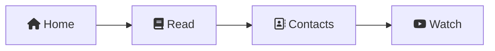
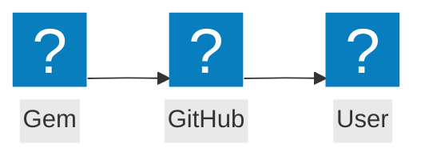

# Icons

The diagram panel and Markdown preview use the same local icon data. Icons are SVG shapes. They work offline and remain in SVG and PNG exports.

## Font Awesome

Use Font Awesome Free icons in labels:



`fas:` selects solid icons, `far:` selects regular icons, and `fab:` selects brand icons. `fa:fa-book` uses a solid icon. `fa:gem` uses the Iconify Font Awesome regular pack, with a solid icon as a fallback. Font Awesome aliases, such as `fas:fa-home`, also work. Pro icons are not included.

For an icon node, use the pack prefix and icon name:



Mindmap syntax such as `::icon(fa fa-book)` is also supported.

## Cloud icons

The `aws:`, `azure:`, and `gcp:` prefixes use only SVGs downloaded directly from AWS, Microsoft, and Google Cloud, plus aliases for those SVGs. Names supplied only by the removed public cloud packages are no longer available. Mermaid Chart packages are not required.

```mermaid
architecture-beta
    service aws(aws:ec2)[EC2]
    service azure(azure:virtual-machine)[Virtual Machine]
    service gcp(gcp:compute-engine)[Compute Engine]
    aws:R --> L:azure
    azure:R --> L:gcp
```



Use `aws:simple-storage-service` or its alias `aws:s3` for S3. Use `azure:virtual-machine` or its alias `azure:virtual-machines` for a virtual machine.

For the S3 Standard resource icon, keep the full resource name:


`aws:res-amazon-simple-storage-service-bucket` selects the bucket resource icon. These resource icons are separate from the general S3 service icon.

AWS also has short resource names, such as `aws:lambda-lambda-function` and `aws:simple-storage-service-s3-standard`. Azure supports the provider file names, such as `azure:10245-icon-service-key-vaults`, and short names, such as `azure:key-vaults`.

Google Cloud uses names such as `gcp:compute-engine`, `gcp:cloud-storage`, and `gcp:vertex-ai`. Category names start with `category-`, for example `gcp:category-ai-machine-learning`. The existing `gcp:vertexai` and `gcp:google-kubernetes-engine` names select the current provider artwork.

## Sources and licenses

| Prefix | Public source | License |
| --- | --- | --- |
| `fa:fa-*`, `fas:`, `far:`, `fab:` | [Font Awesome Free 6.7.2](https://github.com/FortAwesome/Font-Awesome/tree/6.7.2) by Fonticons, Inc. | [CC BY 4.0](https://creativecommons.org/licenses/by/4.0/) for SVG icons |
| `fa:` and `fa6-regular:` | [Iconify Font Awesome 6 Regular](https://icon-sets.iconify.design/fa6-regular/) by Dave Gandy | [CC BY 4.0](https://creativecommons.org/licenses/by/4.0/) |
| `logos:` | [SVG Logos](https://github.com/gilbarbara/logos) by Gil Barbara | [CC0](https://creativecommons.org/publicdomain/zero/1.0/) |
| `mdi:` | [Material Design Icons](https://github.com/Templarian/MaterialDesign) by Pictogrammers | [Apache 2.0](https://www.apache.org/licenses/LICENSE-2.0) |
| `aws:` | [Official AWS architecture icons](https://aws.amazon.com/architecture/icons/), July 31, 2026 | AWS terms for provider assets |
| `azure:` | [Official Azure architecture icons](https://learn.microsoft.com/en-us/azure/architecture/icons/), V24 | Microsoft icon terms for provider assets |
| `gcp:` | [Official Google Cloud icon library](https://cloud.google.com/icons) | Google terms for provider assets |

The build adds sizing and color attributes to the SVGs. The import puts CSS class styles on each SVG element to prevent color conflicts. Icon shapes are unchanged.

## Update provider data

The provider SVGs are saved in `assets/cloud-icons/`. Builds do not download them. [sources.json](../assets/cloud-icons/sources.json) records the download pages, archive URLs, retrieval date, and SHA-256 checksums.

Download each archive from its recorded URL. Save it as `<id>.zip` in one directory, for example `aws.zip` and `gcp-products.zip`. Then run:

```sh
uv run --no-project python scripts/import-cloud-icons.py /path/to/archives
pnpm build:icons
```

The import checks archive hashes before it writes data. For a new provider release, update the URL, hash, and retrieval date in `sources.json`, then import and run the renderer tests. The Azure V24 Foundry Control Plane SVG has an `xviewBox` attribute; the import corrects it to `viewBox`.

See [third-party notices](../THIRD_PARTY_NOTICES.md) for attribution and license notices.
